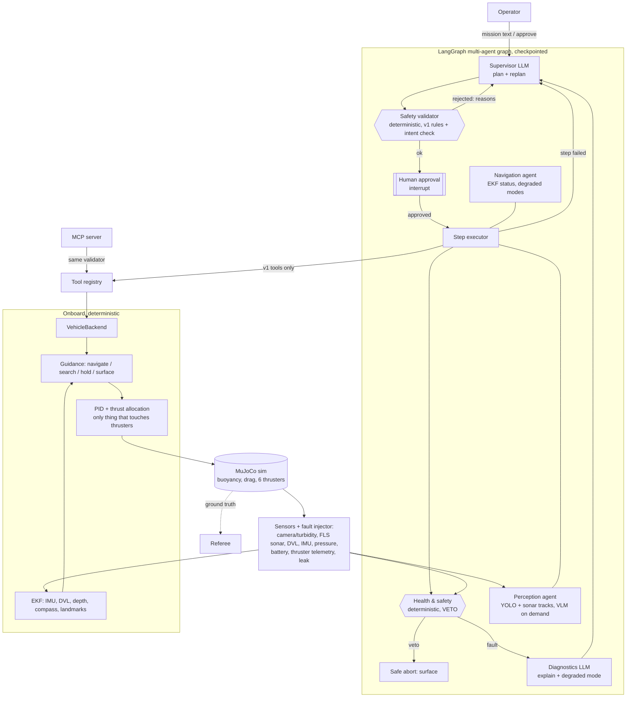

# PLAN — AUV v2: multimodal multi-agent autonomy

v2 builds on v1 ([AUV_LLM_planner](https://github.com/MadLad10/AUV_LLM_planner)): same tools,
plan schema, safety validator, executor semantics and 25-mission eval. It adds a LangGraph
multi-agent layer, a richer simulator with noisy and failing sensors, EKF navigation, a
synthetic-data YOLO detector, VLM queries, an MCP tool server and OpenTelemetry tracing.

## 1. Discovery (2026-10-19/20)

| Item | Finding | Consequence |
|---|---|---|
| OS / ROS | Ubuntu 22.04.5, ROS 2 Humble, kernel 6.8 | keep ament_python packages + colcon |
| GPU | Intel RPL-P iGPU, Mesa 23.2, **OpenGL 4.6** via EGL | headless GPU rendering works (EGL) |
| RAM | 15 GB, 5–10 GB available depending on other projects | one LLM stack at a time; sim must stay light |
| Python | 3.10, no python3-venv → **uv 0.13** venv `.venv` | numpy 1.26.4 (ROS ABI), pytest 7.4.4 (launch_testing plugin) |
| Libraries (PyPI) | mujoco 3.16, langgraph 1.2.16, mcp 2.3, pydantic 2.14 | all from PyPI |
| v1 baseline | copied with rsync, `colcon build` ok, **130/130 unit tests pass** | M1 done |

### 1.1 Simulator feasibility study

| Candidate | What I ran | Result | Integration cost |
|---|---|---|---|
| **Stonefish** | Docker Hub image `srealper/roscon25-stonefish:stonefish_base` (third-party, Stonefish + stonefish_ros2 on **Jazzy**) under `xvfb-run`, Girona500 `underwater_test.scn` | loads (Bullet 3.17, "Ready for running") after fixing `LD_LIBRARY_PATH`; Xvfb means **software GL**, not the iGPU | High: ROS 2 Jazzy in a container ↔ Humble on the host (cross-distro DDS, custom msgs rebuilt in both), unofficial image, building from source needs GitHub + `sudo apt install libglm-dev` |
| **Gazebo Harmonic + DAVE** | official `osrf/ros:jazzy-simulation` (gz-sim 8.11), `gz sim -s --headless-rendering dvl_world.sdf` | server starts; DVL demo needs a Fuel model download (no network in the test). On the host, `ros-humble-ros-gzharmonic-bridge` **conflicts with `ros-humble-ros-gz-bridge`**, so installing it would break v1. DAVE is GitHub-only and its multibeam sonar needs **CUDA** | High: container + cross-distro again, no realistic sonar without NVIDIA |
| **MuJoCo** | `pip install mujoco` in a uv venv; pool + gate + buoy + AUV, EGL camera | **runs natively** next to Humble: physics 616× real time, 640×480 camera **110 fps on the iGPU**, 140 MB RSS | Medium: buoyancy, drag, thruster lag and all marine sensors written by us (≈ what the fault tier needs anyway). Segmentation rendering gives free YOLO auto-labels. Ray casting (`mj_multiRay`) gives sonar and DVL beams |

**Decision (made while the user was away; reversible):** **MuJoCo**, in-process, headless EGL.
Reasons: the only option that runs natively on this Humble host with GPU rendering, the lightest
on shared RAM, deterministic lockstep for evals, and every sensor/fault becomes explicit,
testable Python. v1's Fortress package `auv_sim` stays in the tree (unchanged, still builds) as
the v1 reference. If the user prefers Stonefish later, only `auv_marine_sim` would be replaced:
the onboard, agent and eval layers talk to the `VehicleBackend` interface.

**Honest limits of this choice:** hand-written hydrodynamics (linear + quadratic damping, no
added-mass coupling), ray-cast sonar (no acoustic speckle model), a rasterised camera with
fog/attenuation rather than a physically based underwater renderer.

## 2. Scope (default while waiting for the user)

Core first, in milestone order; the dashboard (M10) is optional. Groq key not yet provided:
everything runs with local Ollama (`qwen2.5:3b-instruct`) and the mock provider; Groq / Groq-vision
columns are filled once `GROQ_API_KEY` is in `.env`.
Names: folder `~/yaad_ws/auv_agentic_v2`, repo [`MadLad10/Agentic-AUV`](https://github.com/MadLad10/Agentic-AUV).

## 3. Architecture



### 3.1 Simulator `auv_marine_sim` (pure Python, MuJoCo)
- World built as MJCF from v1's arena YAMLs (pool 30×20×5 m, gate, 3 buoys).
- Vehicle: v1 hull (0.5×0.3×0.2 m, 29.7 kg, +3 N net buoyancy), buoyancy with partial
  submersion at the surface (so the hull bobs), centre of buoyancy above centre of mass (righting
  moment), v1's linear + quadratic damping, 6 thrusters with first-order lag and per-thruster health.
- Clock: lockstep (deterministic, faster than real time) for evals; agents' thinking time does not
  advance the sim in lockstep (documented limitation; `realtime` mode for demos).
- Sensors (rate, noise, failure modes): camera 640×480 with fog/attenuation (turbidity, blackout);
  forward-looking sonar (ray fan ±60°, 15 m; false target, dropout); DVL 4-beam bottom lock
  (noise, dropout, invalid when out of range); IMU (gyro/accel noise, gyro bias random walk,
  injected bias); compass heading; pressure/depth (noise, stuck); battery (v1 model, sudden drop);
  thruster telemetry (commanded vs actual thrust, current; dead thruster); leak sensor (alarm).
- Fault injector: YAML schedules `{type, t_start, duration, params}`; ground truth of every
  injected fault is logged so diagnostics can be scored.
- Referee: v1 rules (gate pass, buoy touch, windowed surfaced, boundary contacts, max depth) plus
  localisation error (EKF vs truth) and collision count.

### 3.2 Onboard `auv_onboard` (deterministic "vehicle software")
- EKF: state `[x, y, z, vx, vy, vz, yaw, b_gz]`; predict with IMU; update with DVL (body
  velocity), pressure (z), compass (yaw), visual/sonar landmarks against a prior map of the gate
  (configurable), Mahalanobis gating (rejects sonar false targets). DVL dropout → IMU dead
  reckoning; covariance shows it.
- Guidance + controller: port of v1's vehicle_server and PID (anti-windup, vertical speed limit,
  stall recovery when surfacing), driven by the EKF estimate (`nav_source: ekf | ground_truth`).
  Thrust allocation = weighted least squares on the thruster matrix with a health mask, so a dead
  thruster is re-allocated automatically.
- Perception: detector (`ground_truth | hsv | yolo`), sonar contact clustering, camera↔sonar
  association → tracked objects with confidence and sources.
- Health monitor: rule-based checks per sensor (staleness, innovation, telemetry mismatch, leak,
  battery) → `HealthReport {faults[], veto, degraded_modes[]}`.
- `MarineSimBackend` implements v1's `VehicleBackend`, so v1's tool registry, validator and
  single-agent `MissionRunner` run unchanged on the new sim (fair v1-vs-v2 comparison).

### 3.3 Agents `auv_agents` (LangGraph)
| Agent | Kind | Job | Measured by |
|---|---|---|---|
| Supervisor | LLM | plan (v1 schema, constrained decoding), replan, operator messages | pass rate, replans, LLM calls |
| Perception | deterministic + VLM on demand | fused tracks; VLM scene description / failure explanation | mAP, track error, VLM latency |
| Navigation | deterministic | EKF health, degraded nav mode (dead reckoning, slow down) | localisation RMSE vs truth |
| Health & safety | deterministic, veto | sensor/battery/thruster/leak rules | veto precision/recall vs injected faults |
| Diagnostics | LLM | explain fault from telemetry, choose degraded mode from a closed set | fault-ID accuracy vs injected ground truth |
Graph: `supervisor → validator → approval (interrupt) → execute_step ⇄ health/perception/nav →
(diagnostics → supervisor replan) → done/abort`. Checkpointer: SQLite. Streaming: `stream_mode=
"updates"` events go to the JSON trace, OTel spans and the dashboard.

### 3.4 MCP, observability, dashboard
- MCP server (stdio + streamable HTTP) exposes the v1 tools; every motion call passes the
  validator's step check + runtime precheck; no thruster tool exists.
- OpenTelemetry spans (mission → graph node → LLM call with `gen_ai.*` attributes / tool call)
  exported over OTLP to a self-hosted **Jaeger** all-in-one container (`auv2-jaeger`, UI :16686);
  JSON traces kept.
- Optional FastAPI + React dashboard.

## 4. Folder layout
```
auv_agentic_v2/
├── CLAUDE.md (local)  PLAN.md  README.md  .env.example  pytest.ini
├── scripts/   env.sh  setup_venv.sh  start_ollama.sh  ...
├── eval/      missions.yaml  faults.yaml  run_eval.py  results/
├── data/      synthetic/ (gitignored)   models/ (gitignored weights)
└── src/
    ├── auv_mission_interfaces/  auv_mission_planner/  auv_sim/      (from v1)
    ├── auv_marine_sim/          MuJoCo world, vehicle, sensors, faults, referee, autolabel
    ├── auv_onboard/             EKF, guidance, controller, perception, health, backend
    └── auv_agents/              LangGraph graph, agents, VLM, MCP server, telemetry
```

## 5. Milestones
| # | Deliverable | Done when |
|---|---|---|
| M1 | v2 workspace from v1, uv venv, CLAUDE.md, PLAN.md | colcon build ok, 130 tests pass ✅ |
| M2 | MuJoCo sim + sensors + fault injection + referee + backend | scripted gate → buoy → surface passes on ground-truth nav; each sensor/fault unit-tested ✅ |
| M3 | EKF + localisation metrics | same run on EKF nav; RMSE reported nominal vs DVL dropout ✅ (0.09 m vs 0.56 m) |
| M4 | synthetic dataset, YOLO trained, mAP, perception fusion | mAP@0.5 on held-out synthetic set reported; detector `yolo` passes M2 run (dataset ✅, training running) |
| M5 | VLM (Groq vision or small local) with latency budget | scene description + failure explanation, latency logged (client + mock wired in; real model pending key / RAM) |
| M6 | LangGraph graph: supervisor, specialists, HITL, checkpointing | graph runs missions in sim; interrupt/resume test; checkpoint resume test ✅ (mock LLM) |
| M7 | MCP server | MCP client test: unsafe call rejected, safe call executes ✅ |
| M8 | Observability | OTel spans exported, viewable in self-hosted UI ✅ (Jaeger all-in-one; Langfuse rejected: needs Postgres+ClickHouse+Redis+MinIO, too heavy for shared RAM) |
| M9 | Eval: v1 vs v2 on 25 missions + fault tier | Markdown + CSV tables (harness ✅, qwen2.5:3b run in progress) |
| M10 | Optional dashboard; README with media, results, limitations | |

## 6. Open decisions for the user
1. Simulator: MuJoCo chosen (above). Say so if you prefer Stonefish.
2. `GROQ_API_KEY` for the cloud LLM and Groq vision models.
3. ~~Repo name~~ decided: `Agentic-AUV` (folder stays `auv_agentic_v2`).
