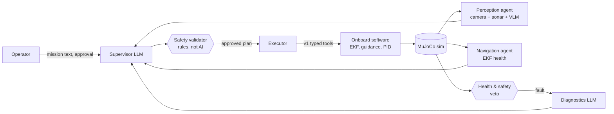

# Agentic AUV: multimodal multi-agent autonomy for an underwater robot

**v2 of [AUV_LLM_planner](https://github.com/MadLad10/AUV_LLM_planner).** v1 was a single LLM agent
that turned plain-English missions into safe, validated plans for an autonomous underwater vehicle
(AUV). v2 keeps v1's tools, plan schema, deterministic safety validator and 25-mission evaluation,
and adds:

- a **LangGraph multi-agent system** (supervisor, perception, navigation, health & safety,
  diagnostics) with **human-in-the-loop** plan approval and **checkpointing**,
- a new **MuJoCo marine simulator** with noisy, failing sensors (camera with turbidity,
  forward-looking sonar, DVL, IMU, compass, depth, battery, thruster telemetry, leak sensor) and
  a **fault injector**,
- **EKF navigation** (visual-inertial-acoustic sensor fusion) scored against ground truth,
- a **YOLO detector trained from scratch on synthetic, simulator-auto-labelled images**,
- on-demand **vision-language model (VLM)** scene queries.

> **Status: work in progress.** Milestones M1–M3 and M6 are done and tested; M4 (YOLO) is
> training; MCP, observability, the v1-vs-v2 evaluation and media are next. See [PLAN.md](PLAN.md).
> Every number below comes from a test or a logged run in this repository.

## How it works



- The **LLMs never touch the thrusters.** They plan and explain; every motion goes through v1's
  typed tools and the deterministic safety validator. Only the onboard PID controller produces
  thruster commands.
- The **health & safety agent is deterministic and has veto power**: a leak, a frozen depth
  sensor, a battery below the floor or a lost depth axis makes the vehicle surface immediately,
  whatever the plan or the LLM says. The diagnostics LLM cannot downgrade a veto (tested).
- A **referee** that only sees simulator ground truth scores every run; the agents' own claims
  are never trusted.

## What already works (tested)

| Camera blackout: diagnosed, replanned, gate found by **sonar alone** | DVL dropout: EKF falls back to IMU dead reckoning + visual landmarks |
|---|---|
|  |  |

*Each panel: third-person view, onboard camera (with detector boxes), forward sonar, top-down map
(white = true path, blue = EKF estimate), live health status. Left: the full LangGraph agent loop
with the LLM's plans replayed from a file for reproducibility (agents, safety checks, sim and referee
all live). Right: a scripted tool sequence (the same tools the agents call).*

| Capability | Evidence |
|---|---|
| Gate → red buoy → surface on **EKF navigation** | 5/5 seeds: gate passed, buoy touched, surfaced, 0 collisions; localisation RMSE **0.12 ± 0.06 m** ([nav study](eval/results/nav_study/summary.md)) |
| DVL dropout → IMU dead reckoning + visual gate landmarks | RMSE **0.44 ± 0.15 m**, 5/5 tasks done. Without the landmarks: **1.70 ± 0.40 m**, and the referee shows the buoy was **missed in 4/5 runs although every tool call reported success** |
| Gyro bias / compass disturbance | absorbed by the EKF (bias estimated, bad compass readings gated out): RMSE 0.12 / 0.15 m |
| Leak / frozen depth sensor | health veto in ≤ 3 s, emergency surface confirmed by the referee |
| Dead thruster | detected from thruster current; the allocator re-distributes thrust; mission still completes |
| Camera blackout | diagnosed → replanned → gate found by sonar alone → gate passed |
| Turbidity | failed search triggers a VLM query and **sonar-cued inspection** |
| YOLO from scratch on synthetic data | closed-loop gate → buoy → surface with the YOLO detector instead of ground truth |
| Human-in-the-loop | LangGraph `interrupt` before execution; resume from a **SQLite checkpoint**; dashboard Approve/Reject |
| MCP tool server | unsafe calls (e.g. 25 m depth) refused by the validator over the MCP protocol; no low-level tool exists |
| Observability | OpenTelemetry spans (mission → agent node → LLM call / tool call) in a self-hosted Jaeger |
| v1 regression | all 130 v1 unit tests still pass |

## Hardware and software

One laptop: Intel i7-13620H, 15 GB RAM shared with other work, Intel integrated graphics (no GPU
compute). Ubuntu 22.04, ROS 2 Humble, MuJoCo 3.16 (headless EGL rendering), LangGraph 1.2,
Ultralytics YOLOv8 (CPU), local LLMs through Ollama, Groq (optional, OpenAI-compatible API).

**Why MuJoCo?** We tried Stonefish, Gazebo Harmonic + DAVE and MuJoCo on this machine (details in
[PLAN.md §1.1](PLAN.md)). MuJoCo was the only one that ran natively next to ROS 2 Humble with
GPU rendering on the integrated graphics (camera at ~110 fps, physics 600× real time, 140 MB RAM).
Its limits: we wrote the buoyancy, drag and sensor models ourselves, and the sonar is ray-cast.

## Run it

```bash
pip install --user uv && scripts/setup_venv.sh          # Python env (no sudo)
source /opt/ros/humble/setup.bash && colcon build --symlink-install
source scripts/env.sh
python -m pytest -m "not integration and not llm"        # tests
python scripts/scripted_mission.py --nav ekf --fault dvl_dropout:10      # no LLM
python -m auv_agents.run "pass through the gate then surface" --provider ollama
python -m auv_agents.run "pass through the gate then surface" --approval interrupt   # you approve
```

## Limitations (so far)

- Simulation only; hand-written hydrodynamics (linear + quadratic damping, no added-mass coupling).
- The sonar is a ray-cast fan with beam-width-aware object returns, not an acoustic model.
- Actions run faster than real time (lockstep, capped). Between actions the sim keeps running in
  real time while the agents think, so LLM latency costs battery as it would on a real vehicle;
  unit tests switch that idle clock off for speed.
- The YOLO detector is trained only on synthetic images.

**Keywords:** agentic AI · multi-agent systems · LangGraph · human-in-the-loop · checkpointing ·
vision-language models (VLM) · sensor fusion · extended Kalman filter (EKF) · synthetic data ·
YOLO · fault injection · AI safety guardrails · LLM evaluation · ROS 2 · MuJoCo · marine robotics
