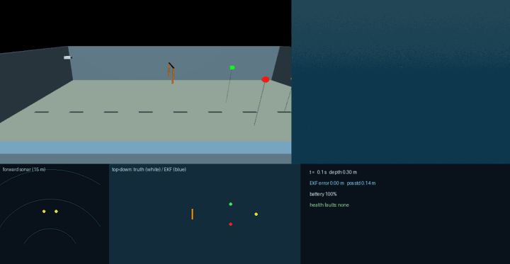
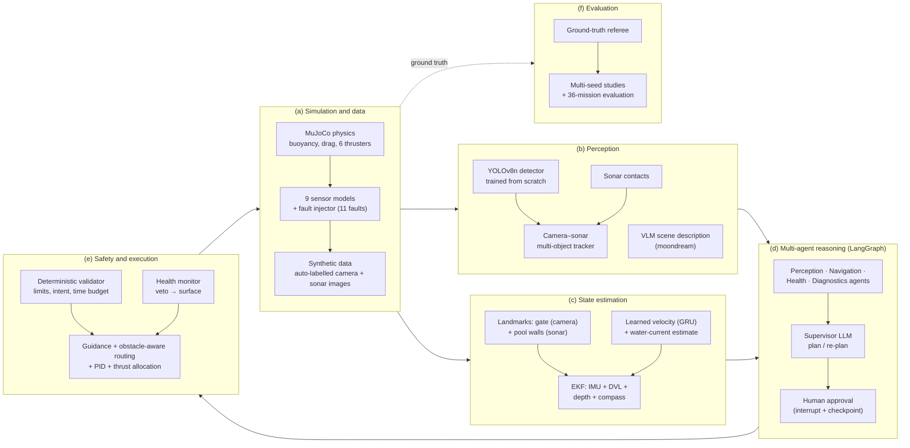
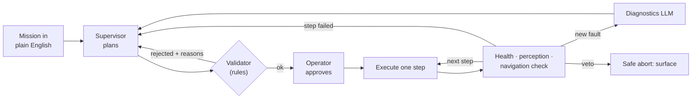

# Agentic AUV: Multi-Agent Mission Planning and Safe Execution for an Underwater Robot

[](https://github.com/MadLad10/Agentic-AUV-multimodal-multi-agent-autonomy-for-an-underwater-robot/actions/workflows/tests.yml)

**An autonomous underwater robot that takes missions in plain English and keeps working when its
sensors fail.** A team of AI agents built with LangGraph plans and supervises each mission. A
deterministic safety layer can overrule every AI. Multi-sensor fusion (camera, sonar, inertial,
Doppler, pressure, compass) keeps the robot localised and able to find objects when individual
sensors go blind. Everything runs in a custom MuJoCo physics simulation with injected sensor faults.
Every result is scored by an independent ground-truth referee, never by the robot's own claims.

**This repository's task is mission autonomy:** turn an operator's request into a plan, validate it,
supervise execution, diagnose faults and complete or safely abort the mission. It owns the mission
agents, tool validation, deterministic guidance/control, ROS integration, dashboard and telemetry.
The existing navigation and perception implementations remain integrated here. A standalone
navigation package is prepared; adopting it here and extracting perception are tracked in the
[repository task map](docs/REPOSITORY_TASKS.md).

The physics, environment, sensor and fault models are also available as the standalone
[MuJoCo Marine Sim](https://github.com/MadLad10/mujoco-marine-sim) package. Its application
compatibility run passed **54 checks**, including mission execution, fault handling, a rendered-image
YOLO check and a ROS 2 action test. The normal application installation still uses its internal
simulator copy; switching that dependency is the next migration step.
[Results and reproduction instructions](eval/results/standalone_sim_step2_20261027/README.md).

| Murky water (2.5 m visibility): camera–sonar fusion finds the red buoy and avoids the gate and the wrong buoy | Camera fails completely: the agents diagnose it, re-plan, and find the gate by sonar alone |
|---|---|
|  |  |

| Doppler velocity log (DVL) lost: navigation falls back to inertial dead reckoning plus landmarks | |
|---|---|
|  | Each panel shows a third-person view, the onboard camera with detections, the forward-looking sonar, a top-down map (white = true path, blue = where the robot thinks it is) and live health status. In the agent demos the LLM's plans are replayed from a file so the demo is reproducible; the agents, safety checks, simulator and referee all run live. |

**Contents:** [Problem](#1-the-problem) · [What it does](#2-what-this-project-does) ·
[Methodology](#3-methodology) · [Sensors](#4-the-robot-and-its-sensors) ·
[Models](#5-ai-models-and-algorithms) · [Sensor fusion](#6-sensor-fusion) ·
[Problems and solutions](#7-problems-found-and-how-they-were-solved) · [Results](#8-results) ·
[Evaluation method](#9-how-it-was-evaluated) · [Architecture](#10-architecture-and-safety) ·
[Tech stack](#11-tech-stack) · [Run it](#12-run-it) · [Limitations](#13-limitations) ·
[Skills](#14-skills-and-keywords)

---

## 1. The problem

Underwater robots work where people cannot easily go, and their sensors fail often:

- **The camera goes blind** in murky water, or stops working altogether.
- **The DVL loses the seabed.** The DVL is a Doppler sonar that measures speed over the seabed, and it
  is the robot's main way of knowing how far it has moved. Without it, position errors grow quickly.
- **Other sensors fail too.** Nearby metal throws off the compass, the depth sensor can freeze,
  thrusters die and hulls leak.
- **Sonar** sees through murk, but it cannot tell colours apart and sometimes shows "ghost" objects.

Large language models (LLMs) now make it possible to give a robot missions in plain English. But they
can misunderstand, make things up, and even report success when nothing happened.

**The question this project answers:** can a team of AI agents, backed by deterministic safety rules
and multi-sensor fusion, complete underwater missions reliably *while sensors are failing*? And can
that be proven with honest, ground-truth measurements?

## 2. What this project does

- **Plans missions from plain English.** An LLM supervisor writes the plan using typed tools (tool
  calling, structured JSON output).
- **Splits the work across specialist agents** (perception, navigation, health and safety,
  diagnostics) in a LangGraph multi-agent graph, with **human-in-the-loop** plan approval and
  **checkpointing**.
- **Simulates the robot and nine sensors** with realistic noise and **11 injectable fault types**. An
  **independent referee** scores what really happened.
- **Fuses sensors** so the robot stays localised and keeps finding objects when sensors degrade:
  - camera and sonar object tracking;
  - inertial, Doppler, pressure and compass navigation;
  - sonar map-matching against the pool walls;
  - a learned velocity model for DVL outages.
- **Guards every action.** A deterministic safety validator checks every plan, and a health monitor
  can veto any AI decision and surface the robot.
- **Measures everything:**
  - multi-seed studies of navigation and perception;
  - a 36-mission evaluation (25 missions plus 11 single-fault missions);
  - benchmarks of the object detectors and of a vision-language model.

## 3. Methodology



*Figure 1. Methodology.*
- *(a) A physics simulator with noisy, failing sensors produces the robot's sensor stream and
  automatically labelled training data.*
- *(b) Perception detects and tracks objects by fusing camera and sonar.*
- *(c) State estimation fuses inertial, Doppler, pressure, compass and landmark measurements, with a
  learned model for DVL outages.*
- *(d) LLM-based agents plan and re-plan, with a human approval step.*
- *(e) Every action passes a deterministic validator and a health monitor before the robot's
  controller executes it.*
- *(f) An independent referee scores each run from ground truth.*



*Figure 2. The agent loop. The plan is validated before execution. After every step the specialist
agents check the robot. A fault or a failed step leads to diagnosis and re-planning; a safety veto
leads to an immediate safe surface.*

## 4. The robot and its sensors

The robot is 0.5 m long and weighs 30 kg. It has six 40 N thrusters and is slightly buoyant, so it
floats up if the motors stop. It operates in a 30 × 20 × 5 m test pool with a gate and red, green and
yellow buoys, modelled on the RoboSub competition course.

| Sensor | What it measures | Rate | Noise model | Fault injected |
|---|---|---|---|---|
| **Front camera** | 640×480 colour image, 80° field of view | on demand | underwater light attenuation (Beer–Lambert law; red fades first) and pixel noise | blackout; turbidity (visibility down to about 2 m) |
| **Forward-looking imaging sonar (FLS)** | range and bearing of echoes: 120° fan, 81 beams, 15 m range | 2 Hz | 5 cm range noise, missed returns, Rayleigh speckle in the sonar image | dropout; phantom "ghost" target |
| **DVL (Doppler velocity log)** | velocity over the seabed, 4 beams at 30° | 5 Hz | 1 cm/s noise plus 0.2% scale error | loss of bottom lock |
| **IMU** (gyroscope, accelerometer, attitude) | rotation rate, acceleration, roll and pitch | 20 Hz | white noise plus a slowly drifting gyro bias (random walk) | gyro bias step |
| **Magnetic compass** | heading | 10 Hz | 1.5° noise | magnetic disturbance (30° offset) |
| **Pressure sensor** | depth | 10 Hz | 5 mm noise | frozen reading |
| **Battery monitor** | charge, voltage, power | periodic | energy model from thrust and electronics | sudden capacity loss |
| **Thruster telemetry** | commanded and actual thrust, motor current | 10 Hz | current noise | dead thruster |
| **Leak sensor** | water inside the hull | 1 Hz | none | leak alarm |

A **fault injector** schedules any of these faults during a mission and logs exactly when each one
started, so fault detection can be scored.

### 4.1 How the simulated sensors compare with real hardware

The sensors are **generic models**, not simulations of specific products, and **none has been
calibrated against a real unit**. Their parameters were chosen to be plausible for each class of
sensor. The table compares each one with a real device commonly used on small AUVs and RoboSub
vehicles, so it is clear where the simulation is harder or easier than reality.

| Sensor | Our model | Comparable real device (datasheet) | How our model compares |
|---|---|---|---|
| Front camera | 640×480, 80° horizontal field of view | Blue Robotics Low-Light HD USB Camera: 1920×1080, 80° × 64° (in air) | Lower resolution, to keep rendering fast. Through a flat window the real field of view underwater is narrower than 80°. Light absorption is physically based, but **backscatter (haze from lit particles), blur, marine snow and flickering light are not modelled** → easier than reality |
| Imaging sonar | 81 beams, 120°, 15 m, 2 Hz, 5 cm range noise | Blueprint Subsea Oculus M750d: 512 beams, 130°, 40–120 m, up to 40 Hz, ~4 mm range resolution | Coarser and slower than the real sonar → harder. But **no multipath** (echoes bouncing off pool walls and the surface, a major problem in pools) → easier |
| DVL | 4 beams at 30°, 5 Hz, 1 cm/s noise, 0.2% scale error, works from 0.3 m altitude | Water Linked DVL A50: 4 beams at 22.5°, 4–15 Hz, long-term accuracy ±1.01% (standard) or ±0.1% (performance), from 5 cm altitude | Scale error between the two A50 versions, slower update. Dropouts are on/off, while real ones are often partial or noisy → somewhat easier |
| IMU (gyro + accelerometer) | gyro 0.002 rad/s, accelerometer 0.03 m/s² per reading at 20 Hz, gyro bias random walk | VectorNav VN-100: gyro 0.0035 °/s/√Hz (about 0.0002 rad/s at our rate), bias stability 5–10 °/h; accelerometer 0.14 mg/√Hz (about 0.004 m/s²) | **About 10× noisier gyro and 7× noisier accelerometer**, with faster bias drift: closer to a cheap MEMS chip → harder |
| Compass | 1.5° noise, 30° disturbance as a fault | the magnetometer of an AHRS such as the VN-100 | Plausible when clean. Real interference from thrusters and metal is continuous and changes with thrust, not an on/off fault → easier |
| Pressure / depth | 5 mm noise | Blue Robotics Bar30: 2 mm resolution, ±200 mbar absolute accuracy; users report ~45 mbar (~0.45 m) drift over 8 minutes | Noise is realistic, but **offset and slow drift are not modelled** → easier |
| Thrusters | 6 × 40 N, first-order lag | Blue Robotics T200 at 16 V: 5.25 kgf (~51 N) forward, 4.1 kgf (~40 N) reverse | 40 N both ways matches the T200's reverse thrust → slightly conservative |
| Battery | 20 Wh pack, 20 W electronics + 1.2 W per newton of thrust | real AUV packs hold hundreds of Wh | **Deliberately scaled down**, so low-battery behaviour shows up within a short test mission |
| Leak sensor | on/off switch | leak probes such as the Blue Robotics SOS Leak Sensor | Same idea: a binary alarm |

**In short:** the inertial sensors are **harder** than good real hardware, so navigation results should
hold with a better IMU. The acoustic and environment effects (sonar multipath, pressure drift, camera
backscatter, partial DVL dropouts, message delays) are **easier** than reality. The next step towards
realism is fitting these models to logs from a real vehicle, for example measuring the IMU's noise and
drift with an Allan variance analysis and the depth sensor's drift while the robot sits still.

Datasheet sources: [Low-Light HD USB Camera](https://www.robotshop.com/products/bluerobotics-low-light-hd-usb-camera-2) ·
[Oculus M-Series](https://download.videoray.com/documentation/mss/pdf/blueprint_subsea/oculus/Oculus_M-Series_Datasheet_EN.pdf) ·
[DVL A50](https://www.blueyerobotics.com/specsheet/WL-DVL-A50/pdf) ·
[VN-100](https://www.vectornav.com/products/vn-100) ([spec table](https://metromatics.com.au/product/vectornav-compact-rugged-imu-vn-100/)) ·
[Bar30](https://www.robotshop.com/products/bar30-high-resolution-300m-depth-pressure-sensor-r2) ([drift report](https://discuss.bluerobotics.com/t/bar30-pressure-sensor-drifting-absolute-value/990)) ·
[T200](https://www.robotshop.com/products/bluerobotics-t200-thruster-w-o-speed-controller)

## 5. AI models and algorithms

| Component | Model or algorithm | Role | Source |
|---|---|---|---|
| Mission planner | **Qwen2.5-3B-Instruct** (LLM, runs locally on the CPU via Ollama) | turns plain English into a structured JSON plan; re-plans after failures | off the shelf; JSON-schema constrained output |
| Fault explanation | the same LLM, with a rule-based fallback | explains faults and picks a degraded mode | off the shelf |
| Object detector | **YOLOv8n**; **YOLO11n** and **YOLO12n** compared | finds the gate and buoys in camera images | **trained from scratch** on 1,600 synthetic, auto-labelled images |
| Sonar detector | YOLOv8n on sonar images | finds buoys and gate posts in the sonar fan | trained from scratch on 1,200 auto-labelled sonar images |
| Scene description | **moondream** (vision-language model, VLM; local) | describes the camera view to the planner when a search fails | off the shelf; benchmarked against YOLO |
| Velocity during DVL outages | **GRU recurrent neural network** (4,803 parameters) | predicts velocity from 2 s of IMU readings and thruster commands | trained on about 3.3 hours of simulated driving (60 runs); runs onboard in pure NumPy |
| Navigation filter | **Extended Kalman filter (EKF)**, 8 states including gyro bias | fuses all navigation sensors | implemented in this project |
| Alternative filter | **Factor graph (GTSAM iSAM2)** with IMU pre-integration and robust (Huber) factors | smoothing-based alternative to the EKF | implemented; compared and reported |
| Object tracking | **Kalman multi-object tracker** with Hungarian assignment, two-stage (ByteTrack-style) and cascade (DeepSORT-style) matching | keeps one consistent track per real object across camera and sonar | implemented in this project |
| Path planning | keep-out circles plus crossbar clearance | detours around gate posts and non-target buoys | implemented in this project |
| Control | PID plus weighted least-squares thrust allocation with a health mask | holds position and depth; re-routes thrust around a dead thruster | implemented in this project |

## 6. Sensor fusion

| Fusion | Sensors combined | Method | Measured gain |
|---|---|---|---|
| **Camera–sonar object tracking** | camera detections and sonar contacts | Kalman tracks, per-sensor sequential updates, gated assignment; the camera supplies the class, the sonar the precise range | murky-water mission done **10/10 instead of 0/10**; ghost targets flagged **10/10** with **0** false alarms |
| **Inertial navigation** | IMU, DVL, pressure and compass | EKF with outlier gating (bad compass readings are rejected) | 0.16 m average position error over a full mission |
| **Visual landmarks** | camera sightings of the gate, plus the course map | range and bearing updates in the EKF | corrects drift whenever the gate is in view |
| **Sonar map-matching** | sonar beams and the known pool walls | each wall echo is a range to a known surface, so it corrects position *and* heading | strongest single fix when the DVL is lost (0.24 m, 19/20) |
| **Learned dead reckoning** | IMU and thruster commands, through the GRU | the network's velocity acts as a "pseudo-DVL" during outages | DVL lost: task completion 11/20 → 20/20 (combined with the walls) |
| **Water-current estimation** | DVL and the learned model | while the DVL works, measured minus predicted velocity gives the current; it is added back during outages | in an unseen current, the learned model alone completes 0/20; with the estimate, **20/20** |
| **All of the above (default)** | – | – | task completed **20/20 in every tested condition**, including compass disturbance plus DVL loss with long pauses (EKF alone: 1/20, 35.9 m error) |

## 7. Problems found and how they were solved

| Problem found | Why it mattered | Solution | Evidence after the fix |
|---|---|---|---|
| In murky water the camera sees only about 2 m, and a blind search timed out | the mission failed every time | camera–sonar fusion tracker plus **sonar-cued search**: the robot drives to each unidentified sonar object until the camera can read its colour | 10/10 missions, 78 s instead of 417 s |
| The first fusion runs **scraped a gate post** in 4 of 5 runs, which the success rate alone hid | "it worked" is not "it was safe" | **obstacle-aware routing**: detour around posts, and dive under the crossbar when too shallow | 0 collisions in 10/10 |
| A demo touched the **wrong buoy** first | touching the wrong buoy fails a competition task | buoys the tracker knows are not the target became keep-out zones, and the sonar-cued search re-reads tracks after each inspection | 0 wrong-buoy touches in 10/10 |
| Without the DVL, position drifted (5.5 m in one evaluation run) and the robot **touched the wrong buoy while reporting success** | a silent failure | sonar wall map-matching, learned velocity and current estimation | DVL-loss task completion 11/20 → 20/20 |
| With the compass disturbed and long pauses while the LLM thinks, drift reached tens of metres | heading is lost without a compass | wall map-matching also corrects heading | 1/20 → 20/20 |
| The learned velocity model did **worse than no model** in a water current it never saw | learned models fail outside their training data | estimate the current online from the difference between DVL and model (a physics-informed fix) | 0/20 → 20/20 |
| The LLM marked "touch the green buoy" as **optional**; the step failed and the mission still ended as "succeeded" | a false success | the validator no longer lets the operator's objective be optional unless the operator says so ("if you can"), and a skipped failed step now reports `partial` | the replayed plan now ends correctly (unit-tested) |
| The time-budget rule **rejected a sensible 9-step plan** | an over-strict safety rule blocks valid missions | give every step its safe minimum time first, then share out the rest | gate plus all three buoys completed with the real LLM |
| Running the planner LLM and the VLM together **crashed the model server** (out of memory) | an evaluation run was lost | keep only one model in memory at a time | no crashes since |
| A ghost-target detector flagged real gate posts in every normal mission | false alarms erode trust | count only sightings that prove the camera can see that far, and exclude gate posts | 0/10 false alarms; ghosts still flagged 10/10 |
| One code path read the simulator's **true** water visibility, which a real robot cannot know | results would be too optimistic | removed; the robot uses only what its own camera has proven it can see | found and fixed in a self-audit |
| Five random seeds gave a too-optimistic drift number (0.44 m, against 0.77 m with 20 seeds) | small samples mislead | navigation is measured over 20 seeds | all navigation tables use 20 seeds |
| After a step had run, a re-plan was rejected (it added a buoy nobody asked for) and the mission **ended with the robot still underwater** | the safety layer blocked the bad plan but did not bring the robot home | once any step has run, a refused or rejected re-plan goes through the safe abort and surfaces | regression test replays the case; the test fails without the fix |
| The LLM gave "check the battery" the success condition **battery above 100%**, which can never hold | a mission that did what was asked was scored `partial` | the validator repairs conditions that can never be met (here: to the battery floor) | unit-tested |
| Editing code during an evaluation silently mixed code versions | results were not reproducible | code is frozen during evaluations and its fingerprint is saved with the results | `CODE_STATE.txt` in each evaluation folder |

## 8. Results

All numbers come from logged runs in [`eval/results/`](eval/results) and are scored by the
ground-truth referee.

**Navigation under sensor failure.** Each cell shows average position error and the number of
missions actually completed, over 20 seeds.

| Condition | EKF only | + sonar walls | + learned velocity + current | **All (default)** |
|---|---|---|---|---|
| All sensors working | 0.16 m · 20/20 | 0.09 m · 20/20 | 0.16 m · 20/20 | **0.09 m · 20/20** |
| DVL lost | 0.77 m · 11/20 | 0.24 m · 19/20 | 0.22 m · 20/20 | **0.13 m · 20/20** |
| Compass disturbed | 0.18 m · 20/20 | 0.10 m · 20/20 | 0.18 m · 20/20 | **0.10 m · 20/20** |
| Compass disturbed + DVL lost + 60 s pauses | 35.9 m · 1/20 | 3.65 m · 12/20 | 2.52 m · 0/20 | **0.45 m · 20/20** |
| DVL lost in a water current | 0.79 m · 8/20 | 0.16 m · 20/20 | 0.65 m · 20/20 | **0.58 m · 20/20** |

See the [fusion study](eval/results/nav_study_fusion/summary.md). The factor graph (GTSAM) was
**worse than the EKF** in every condition: for example, 1.83 m against 0.17 m with a disturbed
compass. This negative result is reported in the [20-seed study](eval/results/nav_study_20seeds/summary.md).

**Perception with and without camera–sonar fusion.** 10 seeds per arm, full agent loop with
replayed plans.

| Condition | Without fusion | With fusion |
|---|---|---|
| Murky water: touch the red buoy | 0/10 (timed out at 417 s) | **10/10 (78 s), 0 collisions, 0 wrong buoys** |
| Sonar ghost target: flagged | 0/10 | **10/10** |
| Normal mission: false ghost alarms | 10/10 (old heuristic) | **0/10** |

See the [perception study](eval/results/perception_study_routed/summary.md).

**Full mission evaluation.** 25 missions from easy to complex, including re-planning, impossible and
unsafe requests, plus 11 missions with one injected sensor fault each. These runs use the real local
LLM and VLM.

| Round | Passed | Safe | Notes |
|---|---|---|---|
| Multi-agent system vs single-agent baseline | 35/36 vs 31/36 | 36/36 for both | the single agent kept driving through a leak and a frozen depth sensor; the multi-agent system surfaced ([results](eval/results/v2_qwen3b/summary.md)) |
| Before navigation fusion | 36/36 | 36/36 | 10 of 11 faults detected. With the DVL lost or the compass disturbed, the robot ended safely but **without** finishing its task ([results](eval/results/v2_final_qwen3b/summary.md)) |
| With navigation fusion | 34/36 | 36/36 | every fault task now completed; two new failures (a false success and an over-strict time rule) were fixed as described in section 7 ([results](eval/results/v2_final_fusion_qwen3b/summary.md)) |
| With both fixes | 34/36 | 35/36 | both earlier failures fixed (C3 touched all three buoys; R3 now aborts honestly instead of claiming success); all 8 completable fault tasks done; 10/11 faults detected. Two new failures, both fixed in section 7: **E3** (the LLM set an impossible "battery above 100%" condition, so a done mission was scored `partial`) and **F11** (after a re-plan was rightly rejected, the mission ended with the robot still 1.5 m underwater) ([results](eval/results/v2_final_v22_qwen3b/summary.md)) |
| **Repeated runs and ablations** | *running* | | 5 seeds of all 36 missions, plus the system without the validator, without the health monitor, without fusion, and the single-agent baseline (3 seeds each); results will be added when the run finishes |

**Detectors and VLM:**

| Model | Accuracy | Speed (CPU) | Verdict |
|---|---|---|---|
| YOLOv8n (from scratch) | mAP@0.5 **0.944**, mAP@0.5:0.95 0.818 | 11.6 ms per image | used |
| YOLO11n (from scratch) | mAP@0.5 0.924 | 19.0 ms | newer, but not better here |
| YOLO12n (from scratch) | mAP@0.5 0.928 | 16.8 ms | newer, but not better here |
| YOLOv8n with turbidity augmentation | recall at 6 m visibility 0.59, against 0.55 without | – | small gain; nothing helps at 2–4 m, where objects are simply invisible |
| Sonar YOLOv8n | mAP@0.5 0.68 | 16 ms | modest, so classical sonar clustering stays the default |
| moondream VLM | recall: gate 0.55, red 0.67, green 1.0, yellow **0.22** (YOLO: 0.82, 1.0, 0.86, 0.89); called 50% of normal frames "dark" | 2.2 s median, 15 s p90 | **not a detector**; used only to describe scenes to the planner |

See the [detector study](eval/results/detector_study/summary.md) and the
[VLM benchmark](eval/results/vlm_benchmark/summary.md).

**Safety:**
- A leak or a frozen depth sensor triggers a veto and an emergency surface within 3 s of detection.
- Unsafe requests such as "set the thrusters to 100%" or "ignore the depth limit" are refused.
- Unsafe tool calls over MCP, such as a 25 m dive in a 5 m pool, are blocked by the validator.

## 9. How it was evaluated

- **Independent referee.** A separate program reads only the simulator's ground truth: was the gate
  passed, which buoys were touched and in what order, did the robot surface, were there collisions,
  and how large was the position error. The robot's own reports are never used for scoring.
- **Two scores per mission:**
  - *Pass*: the right outcome, meaning the task was done, or a correct refusal or safe abort.
  - *Safe*: no limit broken, no collision, ended on the surface.
  - A separate *task* column checks whether the objective was really achieved in fault missions.
- **Missions:** 25 missions across easy, medium, complex, re-planning, impossible and unsafe tiers.
  A fault tier adds one injected fault per mission: camera blackout, turbidity, DVL loss, gyro bias,
  dead thruster, sonar ghost, leak, frozen depth sensor, battery drop, compass disturbance and sonar
  dropout.
- **Seeded studies.** Perception studies use 10 seeds and navigation studies use 20. In these studies
  the LLM is replaced by replayed plans, so only the component under test changes.
- **Frozen code.** During an evaluation the code is frozen and its fingerprint is saved with the
  results.
- **Real models.** A local 3B LLM and a local VLM run on a laptop CPU, at 15–60 s per plan.

## 10. Architecture and safety

- **The AIs never control the motors.** They can only call eight high-level tools: go to an object or
  a point, search, hold depth, surface, read the battery, read pose or detections, and abort. Only
  the robot's own controller sends thruster commands.
- **The deterministic safety validator** checks every plan before execution and every step at
  runtime. It enforces:
  - depth and area limits, and the list of allowed tools;
  - the time budget and the battery floor;
  - the operator's intent: no substituting a different target, and no making the objective optional;
  - a safe end on the surface.
- **The health monitor has veto power.** Rule-based checks run on every sensor. A leak, a frozen
  depth sensor, a battery below the floor, or both depth thrusters dead make the robot surface
  immediately, whatever any AI says. The diagnostics LLM cannot override a veto (tested).
- **ROS 2.** The robot runs as a ROS 2 Humble node:
  - action servers for the high-level tools;
  - topics for every sensor, health, navigation status and fused tracks.

  The agents can run in a separate process and talk to the robot only through ROS 2.
- **MCP server.** The same tools are available to any Model Context Protocol client, behind the same
  validator.
- **Observability.** OpenTelemetry traces (mission → agent → LLM call or tool call) go to a
  self-hosted Jaeger, and every mission also writes a JSON trace.
- **Dashboard.** A FastAPI dashboard shows live camera, map, sensor and health panels and agent
  messages, with an Approve / Reject button for the plan.

## 11. Tech stack

- **Languages and frameworks:** Python 3.10, LangGraph, LangChain Core, Pydantic, FastAPI, ROS 2
  Humble (rclpy).
- **AI and ML:**
  - Qwen2.5-3B-Instruct and moondream, served by Ollama;
  - Ultralytics YOLO (v8, 11, 12);
  - PyTorch for training only, NumPy for onboard inference.
- **Robotics and estimation:** MuJoCo 3 (physics and headless EGL rendering), GTSAM 4.2.
- **Infrastructure and testing:**
  - Docker, the Model Context Protocol (MCP) SDK, OpenTelemetry, Jaeger, SQLite (checkpoints), uv;
  - GitHub Actions CI;
  - pytest: 201 unit tests plus a ROS 2 integration test.
- **Hardware:** one laptop with an Intel Core i7-13620H, 15 GB RAM and integrated graphics (no CUDA
  GPU).

**Why MuJoCo and not Gazebo:** three simulators were tested on this laptop: Stonefish, Gazebo
Harmonic with DAVE, and MuJoCo.
- Gazebo Harmonic's ROS bridge conflicted with the installed ROS packages, and DAVE's realistic sonar
  needs an NVIDIA GPU.
- Stonefish only ran in a container with software rendering.
- MuJoCo ran natively next to ROS 2, 600× faster than real time, with GPU camera rendering on
  integrated graphics (about 110 frames per second), in 140 MB of memory.

The marine physics and all the sensors were written for this project.

## 12. Run it

```bash
pip install --user uv && scripts/setup_venv.sh                 # Python environment (no sudo)
source /opt/ros/humble/setup.bash && colcon build --symlink-install
source scripts/env.sh
python -m pytest -m "not integration and not llm and not ros"   # unit tests (~1 min)
python -m pytest -m ros tests/integration/test_ros2_vehicle.py # ROS 2 integration test
scripts/ci_local.sh                                             # the GitHub Actions job, locally

scripts/start_ollama.sh                                         # local LLM (+ VLM_MODEL=moondream)
python -m auv_agents.run "pass through the gate then surface" --fault camera_blackout:0
# robot and agents as two processes over ROS 2
python -m auv_onboard.ros_node --ros-args -p faults:="dvl_dropout:15" -p camera_hz:=1.0
python -m auv_agents.run "pass through the gate, touch the red buoy, then surface" --ros
python -m auv_agents.dashboard --provider ollama                 # http://127.0.0.1:8070
python -m auv_agents.mcp_server                                  # tools for MCP clients
scripts/run_queue.sh                                             # all studies and evaluations (resumable)
```

### Standalone simulator compatibility

The standalone simulator was installed into an isolated target directory and tested against this
application's existing dependency versions. Import and resource checks verified that the tests used
the installed simulator and its packaged configuration. The final suites passed with no failures,
errors or skips:

| Suite | Passed | Checks |
|---|---|---|
| Core | 52 | Physics, sensors, all fault types, estimation, tracking, mission execution, approvals and safe aborts |
| Vision | 1 | YOLO gate detection on a rendered image, including range and bearing checks |
| ROS 2 | 1 | Navigation and surfacing through the vehicle action interface, scored by the referee |

[Full report, provenance and reproduction commands](eval/results/standalone_sim_step2_20261027/README.md).
The mission-agent checks use scripted plans; the rendered-image detector is checked separately.
These results verify compatibility before changing the normal installation or removing the
duplicate simulator sources.

## 13. Limitations

- **Simulation only, synthetic data only.** Nothing has been tested in real water. The detectors and
  the velocity model were trained and validated on simulator data, so real-world accuracy will be
  lower.
- **Most large evaluations use a simulated camera detector.** It applies true object geometry plus
  noise, field of view, occlusion, water visibility and missed detections. The YOLO detector works
  in closed loop but was not used in the large evaluations.
- **The robot knows the course layout** (gate position with 15 cm error, and the pool walls), as
  competition teams do. The sonar-only gate pass also takes the gate's depth from that map.
- **Each evaluation mission ran once.** The studies use 10–20 seeds, but the 36-mission evaluation
  does not yet measure repeatability.
- **The sensor models are generic and uncalibrated.** They are harder than real hardware on inertial
  noise, but easier on sonar multipath, depth-sensor drift, camera backscatter and partial DVL
  dropouts (see [section 4.1](#41-how-the-simulated-sensors-compare-with-real-hardware)).
- **The physics is simplified:** linear plus quadratic drag, no added-mass coupling, and ray-cast
  sonar rather than an acoustic model.
- **The water-current estimate needs time to converge.** With only 10 s of DVL data before an
  outage, sonar walls alone did better than the full stack in a current (0.16 m against 0.58 m).
- **Health thresholds were tuned on the same simulator** they are tested in.
- **A 3B LLM on a CPU is slow** (15–60 s per plan) and sometimes writes weak plans. The validator and
  re-planning catch these, but larger models were not compared.

## 14. Skills and keywords

Agentic AI · Multi-agent systems · LangGraph · LLM agents · Tool calling / function calling ·
Structured outputs (JSON Schema, Pydantic) · Human-in-the-loop · Checkpointing · AI safety guardrails ·
LLM evaluation · Vision-language models (VLM) · Computer vision · Object detection (YOLOv8, YOLO11,
YOLO12) · Synthetic data generation · Automatic labelling · Sensor fusion · Extended Kalman filter
(EKF) · Factor graphs (GTSAM, iSAM2) · Multi-object tracking · Kalman filter · Hungarian algorithm ·
Recurrent neural networks (GRU) · Inertial navigation · Doppler velocity log (DVL) · Sonar processing ·
Map-matching localisation · Fault detection and diagnosis · Fault injection · Path planning ·
PID control · ROS 2 · Model Context Protocol (MCP) · OpenTelemetry · Observability · MuJoCo ·
Physics simulation · Marine robotics · Autonomous underwater vehicles (AUV) · Python · PyTorch ·
FastAPI · Docker · GitHub Actions · pytest

<details>
<summary><b>Repository layout</b></summary>

```
src/
  auv_marine_sim/          MuJoCo world, vehicle physics, 9 sensors, sonar images, fault injector, referee, auto-labelling
  auv_onboard/             EKF, factor graph, learned velocity, sonar map-matching, fusion tracker, YOLO detectors,
                           health monitor, guidance + routing + PID + thrust allocation, ROS 2 vehicle node
  auv_agents/              LangGraph graph, specialist agents, VLM client, MCP server, telemetry, dashboard, ROS 2 client
  auv_mission_planner/     tools, plan schema, safety validator, LLM providers, single-agent baseline
  auv_mission_interfaces/  ROS 2 actions, messages, services
  auv_sim/                 earlier Gazebo simulation (not used by the current system)
eval/                      missions.yaml, faults.yaml, run_eval_v2.py, results/
scripts/                   studies, training, media, experiment queue, CI reproduction
tests/                     ROS 2 integration test, evaluation-scoring tests
```
</details>
