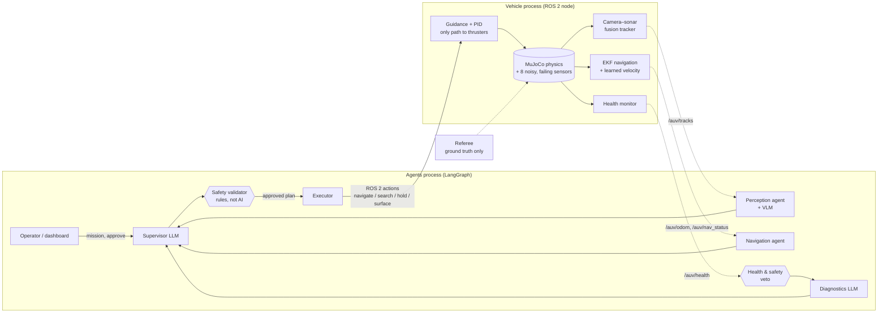

# Agentic AUV: multi-agent autonomy for an underwater robot that keeps working when its sensors fail

**v2 of [AUV_LLM_planner](https://github.com/MadLad10/AUV_LLM_planner).** v1 was a single LLM agent
that turned plain-English missions into safe, validated plans for an autonomous underwater vehicle
(AUV). v2 asks the next question: **what happens when the robot's sensors fail mid-mission?**
It adds a team of AI agents, a simulator full of realistic sensor faults, camera–sonar fusion,
learned navigation, and a deterministic safety layer that can overrule every AI in the system.

| Camera goes black: the agents diagnose it, re-plan, and find the gate **by sonar alone** | DVL lost: navigation falls back to inertial dead reckoning + visual landmarks |
|---|---|
|  |  |

*Each panel: third-person view · onboard camera with detections · forward-looking sonar · top-down
map (white = true path, blue = what the robot believes) · live health status. Left: the full agent
loop, with the LLM's plans replayed from a file so the demo is reproducible (agents, safety checks,
simulator and referee all run live). Right: a scripted sequence of the same tools the agents use.*

---

## Headline results (verified, ground-truth scored)

| Question | Result | Evidence |
|---|---|---|
| Does camera–sonar fusion matter? In murky water (2.5 m visibility), touch the red buoy | **5/5 missions with fusion vs 0/5 without** (70 s instead of timing out at 417 s), 0 wrong buoys touched. **But 4/5 of those runs scraped the gate post** (no obstacle avoidance yet); with the obstacle-aware routing added since: **5/5 done, 0 collisions** (spot check, 5 seeds; full rerun queued) | [perception study](eval/results/perception_study/summary.md), 5 seeds per arm |
| Can it spot a sonar "ghost" (false target)? | **flagged 5/5** with fusion; **0/5 false alarms** on normal missions (the old heuristic raised 5/5) | same study |
| Does the safety layer catch dangerous faults? | leak and frozen depth sensor: **vetoed and surfaced** within 3 s; v1 (no health layer) **kept driving through both** | [v1 vs v2 snapshot](eval/results/v2_qwen3b/summary.md), 72 runs, local LLM |
| Overall, v1 single agent vs v2 multi-agent | **v2 35/36, v1 31/36** missions passed; both 36/36 safe; v2 detected 10 of 11 injected faults | same (dated snapshot, earlier perception code; each mission run once) |
| Detector trained only on simulator images | **YOLOv8n mAP@0.5 0.944**, mAP@0.5:0.95 0.818 on unseen layouts, 10 ms/image on CPU | [detector study](eval/results/detector_study/) |
| Navigation without the DVL (20 seeds) | EKF alone: 0.77 ± 0.43 m error, **task done 10/20** (all 20 *reported* success). With the **learned velocity model** (GRU on IMU + thrust history): **0.19 ± 0.06 m, 20/20**. Without gate landmarks too: 1.32 m / 4/20 → **0.22 m / 20/20** | [nav study, 20 seeds](eval/results/nav_study_20seeds/summary.md) |
| Never trust the robot's own success claim | in 10 of 20 DVL-loss runs (EKF alone) every tool reported success while the **independent referee showed the buoy was missed** | same |
| Factor graph (GTSAM) vs EKF | **negative result:** worse in every condition, e.g. 1.83 m vs 0.17 m under a compass disturbance | same |

> **Still running** (an experiment queue on the laptop; this README is updated when they finish):
> real-VLM benchmark, the v2-only final evaluation (25 missions + 11 faults, real local LLM and
> VLM), YOLO12n and turbidity-augmentation comparison, the sonar detector, the learned-velocity
> model under an unseen water current, and the perception A/B rerun with obstacle-aware routing.

---

## 1. What we built, in plain language

An operator types a mission such as *"pass through the gate, touch the red buoy, then surface"*.
A **supervisor AI** (an LLM) writes a step-by-step plan, a **rule-based safety checker** approves or
rejects it, the operator can **approve it on a dashboard**, and the robot carries it out in a 3D
physics simulation of a test pool.

While it runs, four specialist agents watch the robot:

| Agent | Kind | Its one job |
|---|---|---|
| **Supervisor** | LLM | plan the mission, re-plan when something fails, talk to the operator |
| **Perception** | deterministic + vision-language model | fuse camera and sonar into tracked objects; search with sonar when the camera is blind; ask a VLM to describe the scene when stuck |
| **Navigation** | deterministic | watch the position estimate; slow the robot down when navigation degrades |
| **Health & safety** | deterministic, **veto power** | sensor, battery, thruster and leak checks; can surface the robot at any time, whatever any AI says |
| **Diagnostics** | LLM (with a rule-based fallback) | explain a fault from telemetry and pick a degraded mode; it **cannot** override a safety veto (tested) |

The AIs **never control the motors.** They can only call eight high-level tools ("go to the gate",
"surface", …), and every call passes the deterministic validator from v1. Only the robot's own
PID controller produces thruster commands.

## 2. How it works



The vehicle runs as a **ROS 2 Humble node** that serves **v1's exact action interfaces**
(`/auv/navigate_to`, `/auv/search`, `/auv/hold_depth`, `/auv/surface`) and publishes `/clock`,
odometry, IMU, DVL, depth, battery, detections, health, fusion tracks and sonar/camera images.
The agents run in a separate process and talk to it only through ROS 2; v1's unmodified ROS
client can drive it too (integration test). For speed, evaluations can also run everything in one
process.

The graph has **human-in-the-loop** approval (a LangGraph `interrupt`), **checkpointing** (SQLite,
so a paused mission resumes later), streamed agent messages, an **MCP server** that exposes the same
tools to any MCP client behind the same validator, and **OpenTelemetry** traces (mission → agent →
LLM call / tool call) viewable in a self-hosted Jaeger.

## 3. The environment and the robot

A 30 × 20 × 5 m RoboSub-style pool with a gate and three coloured buoys. The robot is a 0.5 m,
30 kg vehicle, slightly buoyant (it floats up if the motors stop), with six 40 N thrusters.

Everything is simulated in **MuJoCo**. We wrote the marine parts ourselves: buoyancy (including
bobbing at the surface), water drag, thruster lag, underwater light attenuation (red fades first,
murky water washes the image out) and all eight sensors:

| Sensor | Model | Failure modes we inject |
|---|---|---|
| Front camera | 640×480, 80°, depth-based water attenuation, pixel noise | blackout, turbidity (visibility down to ~2 m) |
| Forward-looking sonar | 120° fan, 81 beams, 15 m, ray-cast echoes rendered as a speckled sonar image | dropout, phantom "ghost" target |
| DVL (velocity over the floor) | 4 beams, 1 cm/s noise | loss of bottom lock |
| IMU | gyro + accelerometer noise, slowly drifting gyro bias | gyro bias step |
| Compass | 1.5° noise | magnetic disturbance (30° offset) |
| Depth (pressure) | 5 mm noise | frozen reading |
| Battery | energy drain from thrust + electronics | sudden capacity loss |
| Thruster telemetry / leak sensor | commanded vs actual thrust and current; leak switch | dead thruster; leak alarm |

A **fault injector** schedules any of these during a mission and logs exactly when, so detection
can be scored. A **referee** sees only the simulator's ground truth and decides what really
happened (gate passed? right buoy touched? surfaced? collisions?). It never trusts the agents.

**Why MuJoCo and not Gazebo?** v1 used Gazebo Fortress. For v2 we tested Stonefish, Gazebo
Harmonic + DAVE and MuJoCo on this laptop ([PLAN.md §1.1](PLAN.md)): Harmonic's ROS bridge conflicts
with v1's, DAVE's realistic sonar needs an NVIDIA GPU, Stonefish only ran in a third-party
container with software rendering. MuJoCo ran natively next to ROS 2 Humble, 600× faster than real
time, with GPU rendering on integrated graphics (camera at ~110 fps) in 140 MB of RAM.

## 4. Perception: camera + sonar + AI

- **Detector trained from scratch on synthetic data.** The simulator renders random pool layouts,
  water clarity and camera poses, and labels every image automatically from its segmentation masks
  (only objects actually visible through the water get a label). No hand labelling, no downloaded
  weights.
- **Sonar images.** Sonar echoes are rendered as a realistic fan image (speckle, beam smearing,
  noise floor) and auto-labelled the same way, for a sonar detector.
- **Camera–sonar fusion tracker.** The camera knows *what* an object is but not exactly *where*
  (and goes blind in murk); the sonar knows *where* but not the colour. One tracker fuses both: a
  Kalman filter per object, sensor-by-sensor updates, gated assignment with a matching cascade, a
  class vote from the camera, and logic for "the camera should see this but never does" (ghost
  targets) and "this is a gate post, not a buoy".
- **Sonar-cued search.** When the camera is degraded, the perception agent drives to unlabelled
  sonar objects one by one until the camera can read their colour, instead of a blind search.
- **Vision-language model.** A local VLM (moondream, through our own Ollama container) describes
  the scene when a search fails. What we learned: this small model answers open questions
  ("the balls are green and red") but returns **empty answers to yes/no questions**, and it calls
  our buoys "traffic lights". A benchmark against YOLO on the same frames is running.

## 5. Navigation: where am I without GPS?

- **EKF** fusing IMU, DVL, depth, compass and sightings of the gate (a known course landmark).
  It estimates the gyro bias and rejects compass readings that disagree too much.
- **Learned DVL-outage velocity.** When the DVL loses the floor, a small GRU network (4,800
  parameters, pure-numpy inference onboard) predicts the robot's velocity from the last 2 s of IMU
  readings and its own thruster commands, and feeds the filter as a "pseudo-DVL". Over 20 seeds it
  cuts the error from 0.77 m to 0.19 m and turns 10/20 real successes into 20/20.
- **Obstacle-aware routing.** Moves that would pass too close to a gate post get a detour
  waypoint; crossings under the crossbar that are too shallow are made deeper (the robot still
  passes through the gate when that is the task).
- **Factor graph (GTSAM ISAM2)** with IMU pre-integration and robust kernels, as a drop-in
  alternative. **Negative result:** in our tests it was *worse* than the EKF, badly so under a
  compass disturbance (a persistent 30° offset still leaks through the robust kernel, while the
  EKF's gate rejects it). We report it rather than hide it.

## 6. How we evaluated it

- **Missions:** v1's 25 missions (easy → complex, re-planning, impossible and unsafe requests)
  plus an **11-mission fault tier**, one injected fault each.
- **Studies with seeds:** the perception A/B (fusion on/off) and navigation studies repeat each
  condition over several random seeds; the LLM is replaced by replayed plans there, so only the
  component under test changes.
- **Scoring:** always by the ground-truth referee. "Pass" = the right outcome (done, refused, or
  safely aborted); "safe" = no limit broken, no collision, ended on the surface.
- **LLM:** a local qwen2.5 3B model on the CPU (15–60 s per plan). Groq is supported but optional.

## 7. What testing taught us

- **The robot's own "success" can be wrong.** With the DVL lost and no landmarks, every tool call
  reported success while the referee showed the buoy was missed (4 of 5 runs).
- **Five seeds can lie.** Dead-reckoning drift varies a lot between seeds (worst case 5.4 m); a
  5-seed number we first reported (0.44 m) turned out to be a lucky draw (20 seeds: 0.77 m).
- **"It succeeded" is not "it was safe".** The murky-water fusion result was 5/5, but a per-run
  look showed the robot scraping a gate post in 4 of 5 runs: straight-line moves had no obstacle
  avoidance. We added obstacle-aware routing (detour around posts, duck under the crossbar) and
  now report collisions next to success in every table.
- **Our own fix created false alarms.** The first ghost-target detector flagged real gate posts
  in every normal mission; fixing that briefly disabled real detections too. Both directions are
  now tested.
- **A shortcut slipped in.** An agent once read the simulator's true water visibility, which a
  real robot can't know. Found in an audit and removed; the vehicle now uses only its own estimate
  (from what its camera has recently proven it can see).
- **Small VLMs need the right questions** (open "what" questions, not yes/no).
- **Integration details bite:** ultralytics expects BGR images (RGB made every colour wrong);
  importing torch after creating GPU (EGL) contexts crashed the process; ROS 2 parameters are
  parsed as YAML.

## 8. Run it

```bash
pip install --user uv && scripts/setup_venv.sh                 # Python env (no sudo)
source /opt/ros/humble/setup.bash && colcon build --symlink-install
source scripts/env.sh
python -m pytest -m "not integration and not llm and not ros"   # ~180 tests, ~1 min
python -m pytest -m ros tests/integration/test_ros2_vehicle.py # ROS 2 integration test

scripts/start_ollama.sh                                         # local LLM (+ VLM_MODEL=moondream)
# one process
python -m auv_agents.run "pass through the gate then surface" --fault camera_blackout:0
# two processes over ROS 2
python -m auv_onboard.ros_node --ros-args -p rtf:=1.0 -p faults:="dvl_dropout:15" -p camera_hz:=1.0
python -m auv_agents.run "pass through the gate, touch the red buoy, then surface" --ros
# operator dashboard with plan approval: http://127.0.0.1:8070
python -m auv_agents.dashboard --provider ollama
# tools for any MCP client, behind the safety validator
python -m auv_agents.mcp_server
```

Studies and evaluation: `scripts/perception_study.py`, `scripts/nav_study.py`,
`scripts/detector_study.py`, `scripts/vlm_benchmark.py`, `eval/run_eval_v2.py`, or everything in
order with `scripts/run_queue.sh` (resumable).

## 9. Hardware and software

One laptop: Intel i7-13620H (16 threads), 15 GB RAM shared with other projects, Intel integrated
graphics (no CUDA). Ubuntu 22.04 · ROS 2 Humble · MuJoCo 3.16 (headless EGL) · LangGraph 1.2 ·
Ollama (qwen2.5 3B, moondream) · Ultralytics YOLO (CPU, trained from scratch) · PyTorch (training
only) · GTSAM 4.2 · MCP SDK · OpenTelemetry + Jaeger · FastAPI · Docker · pytest.

## 10. Limitations

- **Simulation only, synthetic data only.** Nothing has been tested in real water; detectors and
  the velocity model are trained and validated on simulator data, so real-world accuracy will be
  lower.
- **Most results use a simulated camera detector** (true object geometry plus noise, field of
  view, occlusion, visibility and misses). The YOLO detector works closed-loop but was not used in
  the large evaluations.
- **Navigation knows the gate's position** from a course map (15 cm error), as competition teams
  do; the sonar-only gate pass also takes the gate's *depth* from that map.
- **The learned velocity model learned this simulator's dynamics** (no currents, no model error in
  training); a test with an unseen water current is running.
- **Hand-written physics:** simplified drag, no added-mass coupling; ray-cast sonar, not an
  acoustic model.
- **The v1-vs-v2 numbers are a dated snapshot** (each mission once, earlier perception code).
- **Health thresholds were tuned on the same simulator** they are tested in.

**Keywords:** agentic AI · multi-agent systems · LangGraph · human-in-the-loop · checkpointing ·
ROS 2 · MCP (Model Context Protocol) · vision-language models (VLM) · sensor fusion · extended
Kalman filter (EKF) · factor graphs (GTSAM) · learned inertial navigation · multi-object tracking ·
camera–sonar fusion · synthetic data · YOLO · fault injection · AI safety guardrails · LLM
evaluation · OpenTelemetry · MuJoCo · marine robotics

<details>
<summary><b>Repository layout</b></summary>

```
src/
  auv_marine_sim/     MuJoCo world, vehicle physics, 8 sensors, sonar images, fault injector, referee, auto-labelling
  auv_onboard/        EKF, factor graph, learned velocity, fusion tracker, YOLO detectors, health monitor,
                      guidance + PID + thrust allocation, VehicleBackend, ROS 2 vehicle node
  auv_agents/         LangGraph graph, specialist agents, VLM client, MCP server, telemetry, dashboard, ROS 2 client
  auv_mission_planner/ auv_mission_interfaces/ auv_sim/   from v1 (tools, plan schema, validator, LLM providers, Gazebo sim)
eval/                 missions.yaml, faults.yaml, run_eval_v2.py, results/
scripts/              studies, training, media, experiment queue, helpers
tests/                integration (ROS 2, v1 Gazebo) and eval-scoring tests
```
</details>
