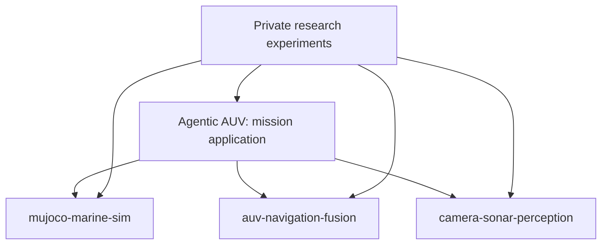

# Repository ownership by task

Prepared: 2026-10-27.

This is the target division of the existing work into four engineering repositories and the existing private research repository. It assigns each implementation a maintained home and records the work needed to reach that structure. Status distinguishes prepared standalone packages from pending application migrations and the planned perception extraction.

## Task boundaries

| Repository | Task / question | Owned implementation | Main output | Current state |
|---|---|---|---|---|
| Existing Agentic AUV repository | How does the robot turn a mission into supervised, validated execution? | Mission agents, planning/replanning, tool schemas and validation, execution, health intervention, guidance/control, ROS adapters, dashboard and telemetry | Executed mission, operator interface, mission trace and end-to-end evaluation | Integrated application exists; currently contains the component implementations listed below |
| `mujoco-marine-sim` | What happens to the vehicle and what do its sensors measure? | Vehicle/world dynamics, sensor models, scheduled faults, rendering, ground-truth annotations and referee | Timestamped simulated observations, explicit truth, annotations and fault/event logs | Standalone package prepared at `../mujoco_marine_sim`; application dependency migration is still needed |
| `auv-navigation-fusion` | Where is the vehicle, how is it moving, and how uncertain is that estimate? | EKF, GTSAM factor graph, navigation measurement updates, sonar map matching, learned velocity recovery and water-current estimation | Estimated pose/velocity, covariance and estimator diagnostics | Standalone package prepared at `../auv_navigation_fusion`; 30 tests passed in both clean source-install and wheel-install environments; application migration remains |
| `camera-sonar-perception` | What objects are visible and where are they relative to the vehicle or a supplied pose? | Camera/sonar detection, association, multi-object tracking, detector training and perception evaluation | Detections, fused tracks, identities, confidence and uncertainty | Candidate implementation is inside `auv_onboard` and study scripts; extraction and independent validation remain |
| Existing private `auv_cvpr` repository | Does a proposed research method answer the paper's question under controlled comparisons? | Literature, hypotheses, experimental methods, frozen protocols, public-data adapters, ablations, diagnostics and paper artifacts | Reproducible experiments, evidence tables, figures and manuscript material | Existing research workspace; this division does not move or publish its contents |

The existing application repository keeps its current GitHub name. These task labels do not require renaming it or creating another copy of the integrated application.

## Source ownership

Paths below are relative to the current Agentic AUV workspace unless stated otherwise. They identify the source of each extraction, not completed file moves.

### Simulation

The standalone simulator becomes the maintained home of:

- `src/auv_marine_sim/auv_marine_sim/{sim,world,faults,referee,sonar_image,autolabel}.py`.
- Vehicle/sensor configuration and arena definitions from `src/auv_marine_sim/config/`.
- Simulator-specific regression tests, fault demonstrations and package documentation.

The camera dataset renderer and segmentation-derived labels stay in the simulator. The perception repository calls that generator and owns training recipes, preprocessing and detector evaluation. The simulator referee owns physical events and truth-derived measurements; the application owns mission-level pass/fail criteria and campaign aggregation.

The simulator has already been copied into a standalone package. The original application still carries its own simulator core. [Step 2 compatibility checks](../eval/results/standalone_sim_step2_20261027/README.md) passed 54 tests with the standalone wheel loaded from an isolated installation, including mission, fault, rendered-image detector and ROS action checks. The normal application dependency setup has not yet been migrated. Finish migration by making the application consume a specific standalone release, checking that normal installation, and then retiring its duplicate implementation. Preserve access to the versions used for earlier results through recorded revisions and manifests.

### State estimation

The standalone package is prepared at `/home/yaad/yaad_ws/auv_navigation_fusion`, with a measurement-driven API, log-replay CLI, packaged model/configuration, tests and an 18-run analytic replay comparison. Its README documents the sensor/technology stack, fresh results and imported historical studies separately. Learned recovery and wall corrections are supported through EKF; unsupported FGO combinations fail explicitly. The original application sources remain in place, and adopting the package here is a separate integration task.

Original source files used for `auv-navigation-fusion`:

- `src/auv_onboard/auv_onboard/ekf.py`.
- `src/auv_onboard/auv_onboard/fgo.py`.
- `src/auv_onboard/auv_onboard/sonar_mapmatch.py`.
- `src/auv_onboard/auv_onboard/learned_velocity.py`.
- Navigation-specific logic currently embedded in `src/auv_onboard/auv_onboard/backend.py`, including measurement scheduling, learned-velocity integration and current estimation.
- Navigation settings currently embedded in `src/auv_onboard/config/onboard.yaml`.
- Relevant functionality from `scripts/gen_nav_data.py`, `scripts/train_dvl_net.py` and `scripts/nav_study.py`, with their dependencies separated first.

This repository estimates state. Guidance, route planning, PID control, thrust allocation, mission tools and health vetoes remain with the application. A future name containing "navigation" must make this narrower state-estimation scope explicit in its README.

Known-map sonar range updates belong here because they correct vehicle state. Recognizing sonar objects and associating object detections belong in perception. Camera landmark updates consume observations and map priors supplied through an adapter; they do not run the camera detector themselves.

Navigation data generation and evaluation may depend on the simulator as an optional experiment dependency. The estimator's core API should accept measurement records without importing the mission application or creating a simulator.

### Object perception

Candidate files for `camera-sonar-perception`:

- `src/auv_onboard/auv_onboard/perception.py`.
- `src/auv_onboard/auv_onboard/tracking.py`.
- `src/auv_onboard/auv_onboard/yolo_detector.py`.
- `src/auv_onboard/auv_onboard/sonar_detector.py`.
- Detection/tracker configuration currently embedded in `src/auv_onboard/config/onboard.yaml`.
- `scripts/train_yolo.py`, `scripts/detector_study.py` and the perception-specific parts of `scripts/perception_study.py`.

Separate the ground-truth camera detector into a clearly labeled simulation/test adapter. Production detection paths must consume rendered images or sensor scans rather than private object annotations.

The current detector adapters receive simulator-related state, and `perception.py` imports an angle helper from the EKF module. Remove those unnecessary core dependencies during extraction. Accept camera calibration and an optional supplied pose/pose covariance as inputs. World-coordinate tracking can use that supplied pose without importing a state estimator or accessing simulator truth.

The application keeps the specialist agent's decisions about inspecting a target, requesting another view or replanning a mission. Reusable recognition and association algorithms can live in perception; the agent calls them through an adapter.

### Mission autonomy and robot execution

Keep in the existing application:

- `src/auv_agents/`: graph, specialists, model-provider integration, approval flow, MCP, dashboard and telemetry.
- `src/auv_mission_planner/`: typed mission plans/tools, validator, executor, planning and tracing.
- `src/auv_mission_interfaces/`: application ROS messages, services and actions.
- `src/auv_onboard/auv_onboard/{control,pathing,health,ros_node}.py`.
- The integration/orchestration layer in `src/auv_onboard/auv_onboard/{backend,factory}.py`, after component algorithms have been extracted.
- Mission definitions, application launch/configuration, end-to-end fault campaigns and integration tests.

There is no separate safety repository in this division: plan validation, health intervention and control must remain testable together in the mission application. Low-level motor commands remain the responsibility of deterministic execution/control after validation of high-level actions.

### Research methods and experiments

Keep the existing private research workspace as the home of paper-specific depth/stereo diagnostics, delayed-observation experiments, reader-aware acquisition, calibration studies, geometric likelihood experiments, comparative protocols and manuscript work.

These experimental methods can use versioned engineering packages. Their results do not establish that every experimental variant should become a separate public project. A method can be extracted later if it gains a stable interface, an independent use case and reproducible supporting evidence.

## Dependency direction and interfaces

The target package dependencies are:

Arrows mean "consumes as a dependency." Simulator-based navigation/perception experiments may also install the simulator; their core algorithms do not require it. The research workspace only installs the components needed for a particular experiment.

At runtime, sensor data flows into state estimation and object perception. Perception may use a supplied state estimate to report world-coordinate tracks; estimation may use supplied landmark observations. The application connects these streams without forcing the two algorithm packages to import each other.

Before each extraction, define its input/output records and document:

- Simulation time versus wall-clock time, timestamps and update rules.
- Coordinate frames, axis conventions and units.
- Validity/dropout behavior, measurement uncertainty and calibration/map inputs.
- Which fields are observations and which are explicitly evaluation-only truth.

Keep component record types with their owning package and put conversion adapters in the application. The existing ROS interfaces stay with the application. There is no additional repository solely for a few shared types or numerical helpers.

## Ownership of experiments and artifacts

Each repository owns its task-specific tests and evaluations. Simulator checks measure simulation behavior; navigation checks measure estimation; perception checks measure detection/tracking; application checks measure mission behavior. Paper comparisons and frozen ablations stay in the research workspace.

The existing study scripts and tests are not all independent: for example, navigation studies call the current backend, perception studies call the mission runtime, and some onboard tests exercise several components. Split tests and harnesses by the behavior they verify; leave end-to-end cases in the application. Copying the complete backend into each package would recreate the overlap.

Model files have an owner too: learned velocity artifacts belong to navigation, and detector artifacts belong to perception. Applications reference a versioned artifact with its checksum and provenance. Generated datasets can be recreated from recorded generator versions, seeds and configurations; their complete contents do not need to be duplicated across code repositories.

## Consolidation of the earlier project list

| Earlier project idea | Home in this task division |
|---|---|
| `agentic-auv` | Existing mission application |
| `mujoco-marine-sim` | Simulator |
| `auv-navigation-fusion` | State estimation |
| `camera-sonar-tracking` | Perception |
| `synthetic-underwater-perception` | Simulator owns image/label generation; perception owns detector training/evaluation |
| `robot-mission-guard` | Mission application |
| `delayed-perception-bench` | Research protocols and experiments |
| `occlusion-tracking-lab` | Research experiments; established tracking implementation belongs in perception |
| `stereo-depth-lab` | Research experiments |
| `perception-calibration-lab` | Research experiments; task-specific calibration utilities may later move into perception |
| `geometric-likelihood-bounds` | Research methods |
| `reader-aware-active-vision` | Research methods |
| `robotics-evaluation-toolkit` | Task-specific evaluation stays with its component; shared paper protocols stay in research |

## Execution order

1. Finish the simulator/application dependency migration. Validate installed-package import resolution, arena/config loading and existing mission/fault behavior before retiring the application's duplicate simulator sources.
2. The standalone state-estimation extraction is prepared and independently validated. Adopt its measurement-driven API in the application through a thin adapter, then validate that integration before retiring duplicate navigation sources.
3. Extract perception with image/scan inputs, explicit calibration and an optional supplied pose. Keep simulation truth adapters separate, port its training/evaluation recipes, and verify detector/tracker behavior independently and through the application.
4. Update the application to install identified component versions. Run integration checks and retain end-to-end demonstrations and mission reports there.
5. Record dependency versions in research experiment manifests as the engineering packages become available. Preserve original result provenance when changing dependencies.

For each engineering repository, the README must explain its task, what was implemented, technology and sensor stack, input/output contract, installation, runnable examples, evaluation evidence and practical model limits. A repository is ready only after its documented install/run path works outside the original workspace.

The task map records the division; the linked Step 2 report records isolated compatibility verification. Runtime code has not been moved, the normal application dependency setup is unchanged, and no Git writes are performed by the verification workflow.
